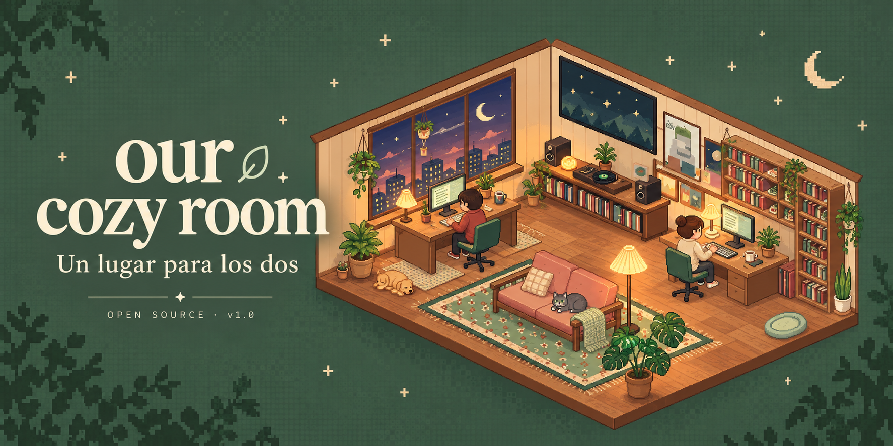
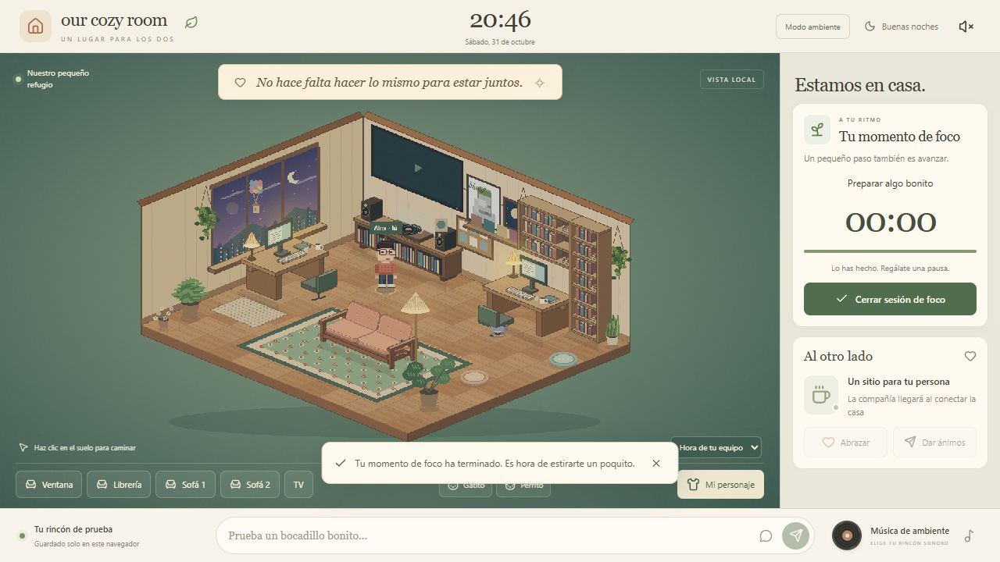
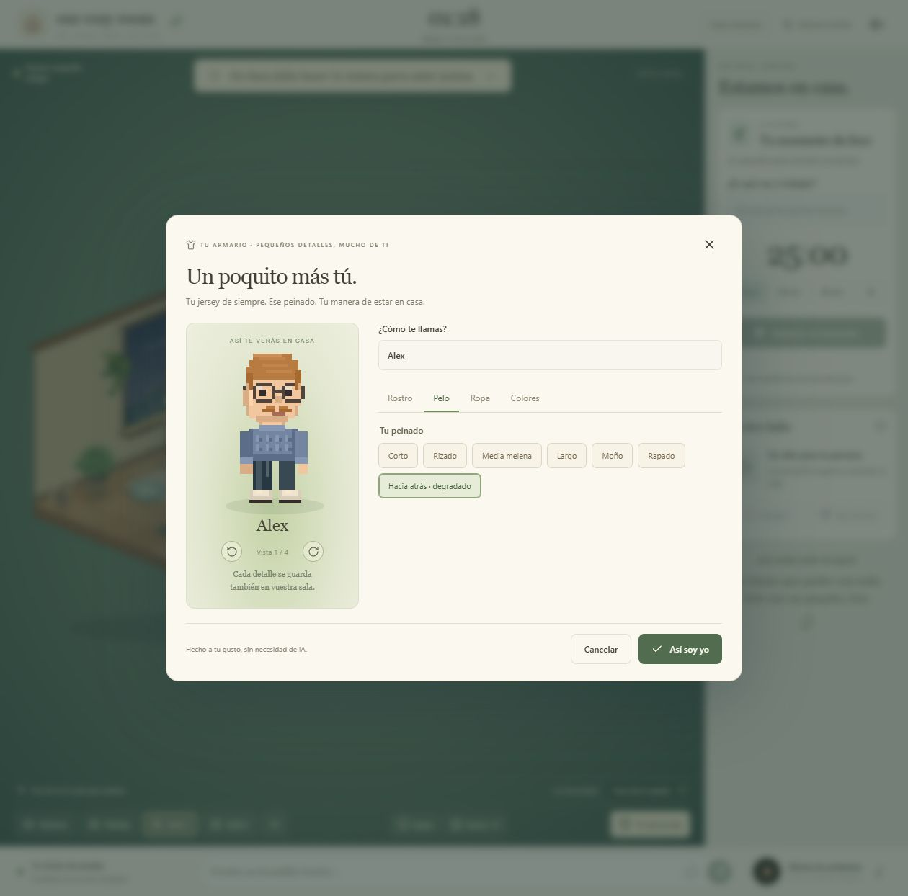
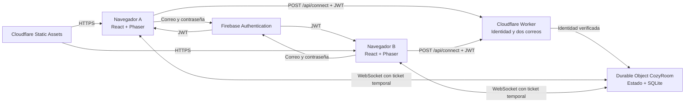

<div align="center">



# Our Cozy Room

**Un lugar para los dos.**

Una habitación virtual privada para acompañaros mientras trabajáis, estudiáis o simplemente pasáis tiempo frente al ordenador.

[](package.json)
[](LICENSE)
[](#tecnología)
[](docs/SETUP.md)

[Explorar en local](#probar-en-tu-ordenador) · [Instalar vuestra casa](docs/SETUP.md) · [Arquitectura](docs/ARCHITECTURE.md) · [Contribuir](CONTRIBUTING.md)

</div>

---

## Compartir el día, a vuestro ritmo

Hay días en los que cada uno está a lo suyo durante horas. Our Cozy Room nace para que, incluso entonces, podáis sentiros cerca.

Entra en vuestra casa y encuentra a tu persona trabajando junto a la ventana. Siéntate en tu escritorio, empieza una tarea y deja la habitación en una pestaña o un segundo monitor. Un bocadillo, un abrazo o un pequeño «ánimo» pueden acompañar el resto del día.

Una persona prepara la instalación una vez. Después, cada uno entra desde su navegador con su propia cuenta y correo verificado. La casa vive en Cloudflare y se recupera al acceder, sin mantener un ordenador anfitrión encendido.

El banner es una ilustración promocional generada con IA. La siguiente imagen es una captura real de la aplicación con datos ficticios.



## Lo que podéis hacer en la 1.0

| Vuestro rincón | Cómo se siente |
| --- | --- |
| **Estar juntos** | Dos personajes en una sala isométrica compartida, movimiento por clic, dos escritorios y un sofá con dos plazas. Al pulsar un asiento, el personaje camina y se sienta al llegar. |
| **Concentrarse** | Tareas individuales de 1 a 240 minutos, con pausa y reanudación. En «Al otro lado» ves la tarea, el estado, la duración y el tiempo restante de la otra persona conectada. |
| **Dar compañía** | Mensajes en bocadillos, avisos sonoros opcionales, contador en el título de la pestaña y abrazos y ánimos al acercaros. |
| **Pareceros a vosotros** | Editor manual con piel, siete peinados, barba, bigote, gafas y ropa. Pelo y barba tienen colores independientes. |
| **Hacer una pausa** | Un gato gris y un perrito dorado que pasean, descansan y vuelven a sus camas. Puedes acercarte y acariciarlos. |
| **Poner algo de fondo** | TV mural con enlaces de YouTube, mando plegable y volumen individual. Tres grabaciones de piano con selector, pausa y volumen. |
| **Dejar pasar las horas** | Luz gradual según la hora del equipo, nubes, pájaros y pequeños acontecimientos en la ventana. Los personajes sentados hacen gestos suaves. |
| **Quedarse un rato** | Modo ambiente para dar protagonismo a la habitación y respeto a la preferencia de movimiento reducido del sistema. |

<details>
<summary><strong>Un vistazo al editor de personajes</strong></summary>



El editor se organiza en Rostro, Pelo, Ropa y Colores. Puedes girar la previsualización y cancelar sin guardar. Incluye cinco tipos de prenda superior y cuatro inferiores.

</details>

## Probar en tu ordenador

Necesitas **Node.js 22.12 o posterior** y npm. El flujo de validación utiliza Node.js 24.

1. Descarga o clona este repositorio y abre una terminal en su carpeta.
2. Instala las dependencias y arranca la vista local.

```sh
npm ci
npm run dev
```

3. Abre la URL que muestra Vite, normalmente [127.0.0.1:5173](http://127.0.0.1:5173/).

Sin configuración de Firebase, el servidor de desarrollo abre una **vista local explícita**. Puedes probar el mobiliario, el editor, las mascotas, las tareas, los bocadillos, la música y la TV. Los cambios se guardan en ese navegador y la vista tiene un único participante.

Si ya has configurado Firebase y quieres abrir la demo, añade `?demo=1` a la URL. Esta opción utiliza estado local separado y nunca permite acceder a la casa privada.

**Para que dos personas se vean necesitáis la instalación conectada.** Sigue la guía de [configuración y despliegue](docs/SETUP.md).

## Instalar vuestra casa

La instalación utiliza dos servicios con planes gratuitos disponibles.

| Servicio | Responsabilidad |
| --- | --- |
| **Firebase Authentication** | Cuentas con correo y contraseña, verificación de correo y recuperación de contraseña. |
| **Cloudflare Static Assets** | Archivos de la web, motor de la escena y grabaciones de piano. |
| **Cloudflare Worker** | Validación de la identidad y autorización de los dos correos de vuestra casa. |
| **Cloudflare Durable Objects con SQLite** | Estado persistente y comunicación entre navegadores mediante WebSockets hibernables. |

Una instalación representa **una casa para dos personas**. Quien la administra configura dos correos autorizados en el backend. Cada persona crea su cuenta y verifica su correo desde la web.

El recorrido completo está en [docs/SETUP.md](docs/SETUP.md), con instrucciones para crear los servicios, copiar las plantillas, probar las cuentas, publicar en una URL `workers.dev` y revisar el resultado.

<details>
<summary><strong>Archivos de configuración y privacidad</strong></summary>

| Archivo o secreto | Contenido | Uso |
| --- | --- | --- |
| `.env.local` | `VITE_FIREBASE_API_KEY`, `VITE_FIREBASE_AUTH_DOMAIN`, `VITE_FIREBASE_PROJECT_ID` | Configuración pública de Firebase, incorporada al compilar. |
| `.dev.vars` | `FIREBASE_PROJECT_ID`, `ALLOWED_EMAILS` | Backend local de Wrangler. |
| Secretos de Cloudflare | `FIREBASE_PROJECT_ID`, `ALLOWED_EMAILS` | Backend desplegado en Internet. |

Copia las plantillas [.env.example](.env.example) y [.dev.vars.example](.dev.vars.example). Los archivos locales con valores reales están excluidos de Git.

Las opciones `VITE_*` se incluyen en el navegador. La lista de correos autorizados debe existir únicamente en el backend. No introduzcas una clave administrativa de Firebase ni un JSON de cuenta de servicio en el frontend.

Cambiar `.dev.vars` afecta a las pruebas locales. Para cambiar los correos del despliegue hay que actualizar el secreto de Cloudflare. Si una cuenta ya ocupaba una plaza, cambiar el correo autorizado no sustituye su identificador persistido. Consulta [SECURITY.md](SECURITY.md).

</details>

### Alojamiento y coste

El objetivo es mantener una casa pequeña dentro de las cuotas gratuitas de Firebase y Cloudflare. El backend puede hibernar y recuperar su estado en la siguiente interacción. Cada navegador dibuja y anima la habitación.

El uso está sujeto a los límites del proveedor. El consumo durante jornadas largas y la reentrada tras inactividad necesitan validación en cada instalación. Consulta las condiciones vigentes de [Workers](https://developers.cloudflare.com/workers/platform/pricing/), [Durable Objects](https://developers.cloudflare.com/durable-objects/platform/pricing/) y [Firebase Authentication](https://firebase.google.com/docs/auth/limits).

## Tecnología

| Capa | Tecnologías |
| --- | --- |
| Interfaz | React 19, TypeScript, Vite, CSS e iconos de Lucide |
| Escena y personajes | Phaser 3, geometría isométrica procedural y sprites definidos en código |
| Contratos compartidos | Zod, reglas de sala, caminos, asientos, foco y mascotas |
| Identidad | Firebase Authentication y validación JWT con `jose` |
| Servidor y persistencia | Cloudflare Workers, Durable Objects y SQLite mediante la API de clave/valor |
| Tiempo real | WebSocket y snapshots de estado |
| Desarrollo y pruebas | Wrangler, Vitest y workerd/Miniflare |

## Cómo llega un mensaje al otro lado



1. Firebase identifica a cada persona y emite un token.
2. El Worker verifica firma, proyecto, caducidad, correo verificado y lista de acceso.
3. La casa entrega un ticket aleatorio de un solo uso que caduca en 30 segundos.
4. El navegador abre el WebSocket con ese ticket. El token Firebase se mantiene fuera de la URL.
5. El Durable Object valida cada acción y guarda el nuevo estado antes de emitirlo a los clientes conectados.

Los navegadores reciben el estado y dibujan la escena. El foco usa marcas temporales, y los paseos de las mascotas se calculan a partir del reloj compartido. Así evitamos ejecutar un bucle de juego continuo en el servidor.

El [documento de arquitectura](docs/ARCHITECTURE.md) explica persistencia, hibernación, acceso, datos y desconexiones.

## Privacidad y comportamiento de los medios

- **Acceso privado.** Tener una cuenta Firebase no basta. El backend exige un correo verificado autorizado y mantiene un máximo de dos miembros.
- **Historial acotado.** Se conservan los diez mensajes más recientes dentro de una ventana de 24 horas. El borrado físico por antigüedad ocurre en la siguiente carga o mutación del estado.
- **Avisos al otro lado.** Activa el altavoz de la cabecera para escuchar un aviso suave con los mensajes recibidos. Si la habitación está en otra pestaña o ventana sin foco, el título muestra «💌 Tienes un mensaje» y acumula los mensajes nuevos. Se limpia al volver. El título avisa también con el sonido desactivado. La pestaña debe permanecer abierta y conectada; la suspensión del navegador puede retrasar la recepción.
- **Música individual.** Las grabaciones de piano se sirven desde vuestra instalación. Cada persona controla su reproducción y los créditos permanecen visibles.
- **TV compartida.** Encender o cambiar el vídeo afecta a ambos. Cada persona elige su volumen. YouTube se carga al encender la TV y recibe las peticiones habituales del navegador. La sincronización se calcula al entrar, con las limitaciones de autoplay, anuncios, pausa local y suspensión de pestañas.
- **Datos locales.** La demostración conserva su estado en el navegador. La casa conectada utiliza el estado de Cloudflare.

Las consideraciones de revocación, abuso, cuentas, datos y copias de seguridad están en [SECURITY.md](SECURITY.md).

## Alcance y límites de la 1.0

La aplicación está implementada y cuenta con pruebas automatizadas de dominio y del backend con dos clientes. El primer despliegue privado y la primera entrada han sido comprobados. La validación manual completa con dos personas en Internet, recuperación de contraseña, redes interrumpidas y consumo prolongado siguen pendientes.

| Área | Estado |
| --- | --- |
| Sala, editor manual, foco, chat, mascotas, TV y piano | Implementados |
| Validación del Worker y persistencia tras reiniciar workerd | Cubiertas por integración local |
| Clima meteorológico y amanecer astronómico | Pendientes. La iluminación actual sigue la hora del dispositivo. |
| Personaje a partir de una foto e integración de IA | Pendientes. El editor manual funciona sin IA. |
| Spotify | Sin integración. El tocadiscos es decorativo. |
| Invitaciones desde la interfaz, reemplazo administrativo de miembros y exportación/restauración | Pendientes |
| Revocación inmediata, protección de admisión y pruebas largas de redes/consumo | Pendientes de endurecimiento y validación |

El movimiento lógico llega al destino antes de terminar la animación visual, lo que puede afectar a la proximidad durante el trayecto. Abrir la misma cuenta en otra pestaña sustituye su conexión anterior.

## Desarrollar y comprobar cambios

| Comando | Resultado |
| --- | --- |
| `npm run dev` | Vite en localhost, con proxy de `/api` al puerto 8787 |
| `npm run typecheck` | TypeScript del cliente y del Worker |
| `npm test` | Pruebas unitarias de dominio y cliente |
| `npm run build` | Comprobación de tipos y salida estática en `dist/` |
| `npm run worker:dev` | Worker y archivos compilados mediante Wrangler |
| `npm run test:integration` | Compilación, empaquetado sin despliegue y ensayo local con dos clientes |
| `npm run deploy` | Compilación y publicación en la cuenta Cloudflare autenticada |

La integración utiliza claves RSA de prueba y una respuesta JWKS local. Comprueba rechazo de identidades, tickets de un uso, presencia, chat, foco independiente, colisiones, ocupación de asientos, TV, caricias, retención y recuperación tras reiniciar el runtime.

El workflow de [validación](.github/workflows/ci.yml) ejecuta las pruebas en pushes y pull requests. Los tests emplean datos ficticios y no necesitan los secretos de una casa real.

```text
our-cozy-room/
├── src/
│   ├── components/     Interfaz, editor, foco, música y TV
│   ├── game/           Escena Phaser, luz y poses
│   └── lib/            Clientes local/remoto, Firebase y sonido
├── shared/             Modelo, validación, caminos y avatares
├── worker/             API, autenticación y Durable Object
├── tests/              Pruebas unitarias y de integración
├── public/             Archivos estáticos, audio y créditos
└── docs/               Instalación, arquitectura y recursos
```

## Participar

Las mejoras pequeñas y verificables son bienvenidas. Para preparar una contribución, consulta [CONTRIBUTING.md](CONTRIBUTING.md). Usa una instalación propia y datos ficticios al reproducir problemas.

Para un fallo de seguridad, sigue el procedimiento privado de [SECURITY.md](SECURITY.md).

## Licencias y agradecimientos

El código, escenario procedural y definiciones originales de personajes se distribuyen bajo [MIT](LICENSE).

Las tres grabaciones de A-M Classical se distribuyen bajo **CC BY 3.0 US** y conservan su atribución en la interfaz y en los [créditos de audio](public/audio/CREDITS.md). Los vídeos de YouTube pertenecen a sus titulares. Las dependencias mantienen sus licencias.

El banner es una ilustración editorial generada con IA, inspirada en la sala. Las imágenes de la sección de producto son capturas reales con datos ficticios. La procedencia de los recursos está documentada en [docs/ASSETS.md](docs/ASSETS.md).

<div align="center">

✧

**Un pequeño refugio, al otro lado de la pantalla.**

</div>
