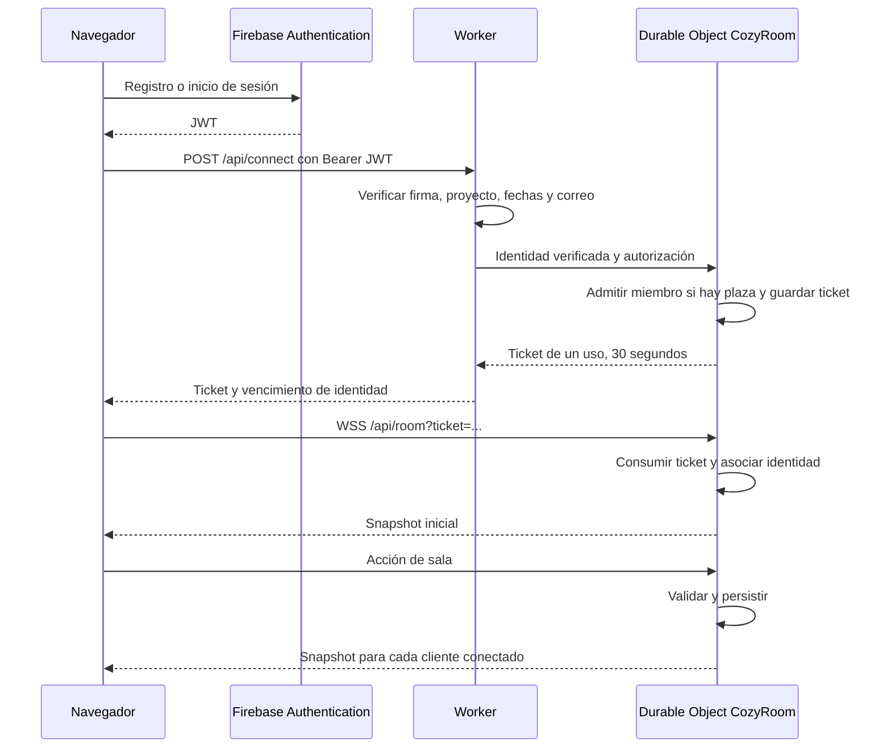

# Arquitectura de Our Cozy Room

Una instalación aloja una habitación privada para dos personas. Los navegadores dibujan la escena, Firebase gestiona las cuentas y Cloudflare conserva el estado compartido.

## Componentes y responsabilidades

| Componente | Implementación | Responsabilidad |
| --- | --- | --- |
| Interfaz | React, TypeScript y CSS | Acceso, editor, foco, controles, chat y estados de conexión |
| Escena | Phaser 3 | Proyección isométrica, geometría, personajes, animaciones y clics |
| Modelo compartido | Zod y módulos de `shared/` | Validar acciones, avatares, rutas, asientos, tareas, TV y mascotas |
| Archivos | Cloudflare Static Assets | Servir `dist/`, incluidos audio y cabeceras |
| Identidad | Firebase Authentication | Registro, contraseña, correo verificado y recuperación |
| Entrada | Cloudflare Worker | Verificar JWT y autorizar dos correos |
| Coordinación | Durable Object `CozyRoom` | Miembros, tickets, WebSockets y validación de acciones |
| Persistencia | SQLite del Durable Object | Estado mediante `ctx.storage.get/put`, API de clave/valor |

La configuración de despliegue está en `wrangler.jsonc`. El Worker intercepta `/api/*`; los demás recursos se sirven como archivos estáticos con fallback de SPA.

## Entrada y tiempo real

El endpoint de WebSocket pasa por el Worker y el control de origen antes de llegar al Durable Object. El diagrama resume esa conexión como navegador ↔ casa.

La firma RS256 se valida con las claves públicas de Google y `jose`. Se comprueban emisor, audiencia, fechas, identificador y correo verificado. La lista del servidor contiene exactamente dos correos distintos. El estado de la casa admite un máximo de dos UIDs, que identifican cuentas Firebase concretas.

El JWT no aparece en la URL del WebSocket. El ticket sí viaja en la URL, dura 30 segundos y se consume una vez. La observabilidad persistente está desactivada para evitar registrar esas URLs.

Una conexión conserva su identidad en un attachment serializado. La expiración cierra los sockets y el cliente intenta renovar/reconectar. Otra pestaña de la misma cuenta sustituye a la anterior.

## Qué se guarda

| Clave | Contenido |
| --- | --- |
| `state` | Revisión y versión del modelo, miembros con avatar/posición/asiento/foco, últimos mensajes, TV y estado determinista de mascotas |
| `tickets` | Tickets de acceso con vencimiento e identidad asociada |

Los dos valores se guardan mediante la API KV del Durable Object con almacenamiento SQLite. La aplicación no define tablas SQL públicas de usuarios o mensajes.

El chat conserva hasta diez mensajes dentro de las últimas 24 horas. Los snapshots filtran la antigüedad. La eliminación física por tiempo ocurre al cargar o modificar el estado.

Una acción válida se persiste antes de emitir el snapshot. Las reglas del servidor controlan caminos, colisiones, plazas, revisiones de foco y TV, tamaño y frecuencia de mensajes. El limitador actual es por conexión y se reinicia al reconectar.

Las preferencias de volumen y los controles de reproducción local pertenecen a cada navegador. La demo tiene un estado independiente en `localStorage`.

## Hibernación y reloj

El Durable Object usa WebSockets hibernables y carece de un bucle de animación permanente. Al reactivarse, carga el estado persistido y normaliza los datos anteriores.

- Los navegadores animan figuras, luz, cielo y decoración.
- El foco conserva duración, tiempo restante, instante de finalización y revisión.
- Las mascotas utilizan origen, época y última caricia para calcular recorridos reproducibles.
- El servidor emite su hora junto al snapshot y el cliente calcula un desplazamiento de reloj.
- Una alarma atiende el vencimiento de las identidades conectadas.

La reentrada tras inactividad y las cuotas reales deben comprobarse en cada despliegue.

## Servicios externos y archivos

El iframe de YouTube solo se crea al encender la TV. La casa conserva ID de vídeo, instante de inicio y revisión. El navegador carga la API y el reproductor oficial directamente. No se descargan vídeos en el Worker.

Los tres MP3 de piano son archivos estáticos con licencia CC BY 3.0 US. Cada navegador controla su pieza y volumen. El tocadiscos de la escena es decorativo.

La instalación utiliza Firebase exclusivamente para identidad. No hay base de datos Firebase, Supabase, Spotify ni generación de avatares con IA en esta versión.

## Compilar y desplegar

1. Vite incorpora la configuración pública `VITE_FIREBASE_*` y produce `dist/`.
2. Wrangler empaqueta el Worker, carga los archivos y conecta `ROOM` con `CozyRoom`.
3. La migración inicial crea almacenamiento SQLite para el namespace.
4. Los secretos remotos aportan `FIREBASE_PROJECT_ID` y `ALLOWED_EMAILS`.
5. La pareja entra por HTTPS en la URL `workers.dev` de su instalación.

La base de datos local de Wrangler y el Durable Object remoto son estados independientes. Publicar código no importa los perfiles ni mensajes locales.

Consulta [SETUP](SETUP.md) para instalar y [SECURITY](../SECURITY.md) para revocación, abuso, gestión de miembros y recuperación. Las pruebas y las limitaciones de producción se describen en el [README](../README.md).
